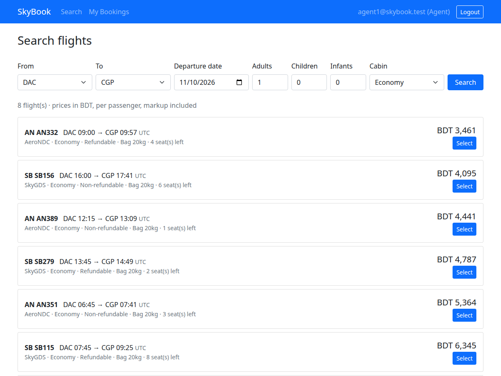
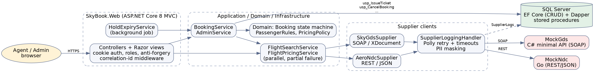
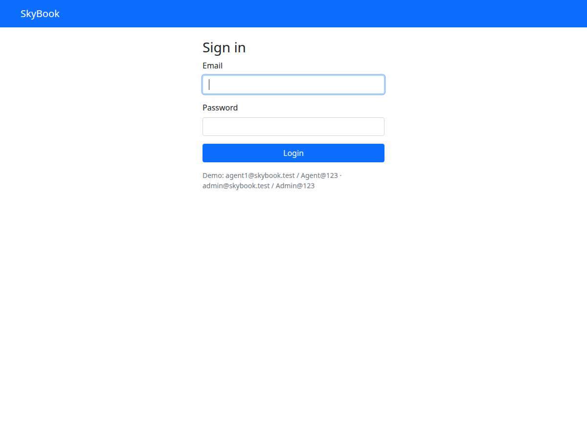
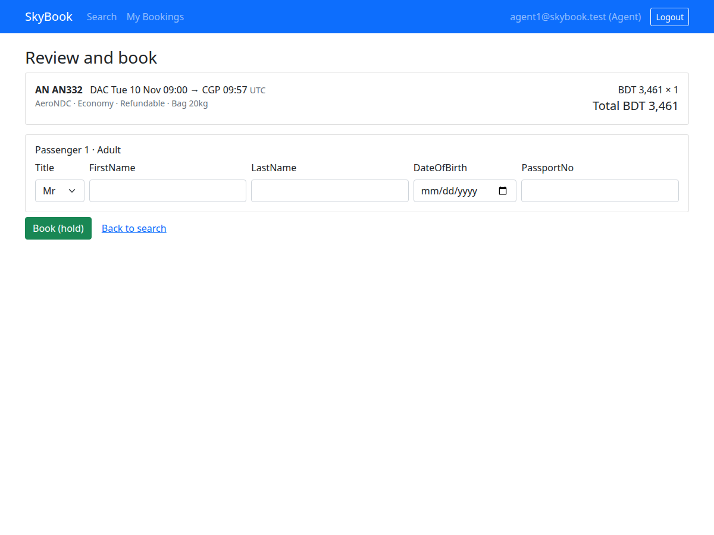
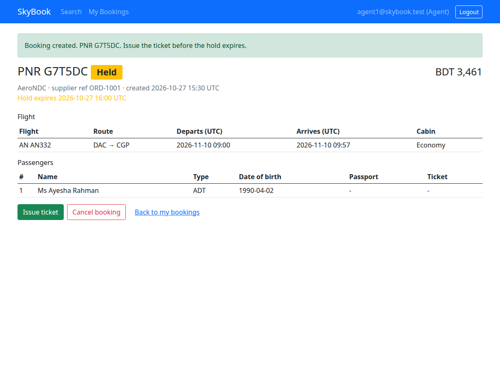
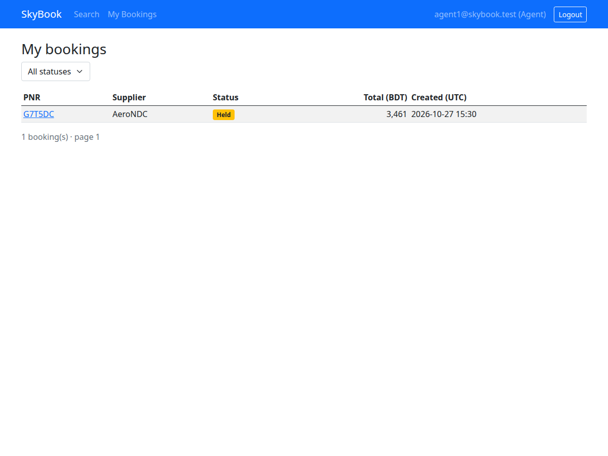
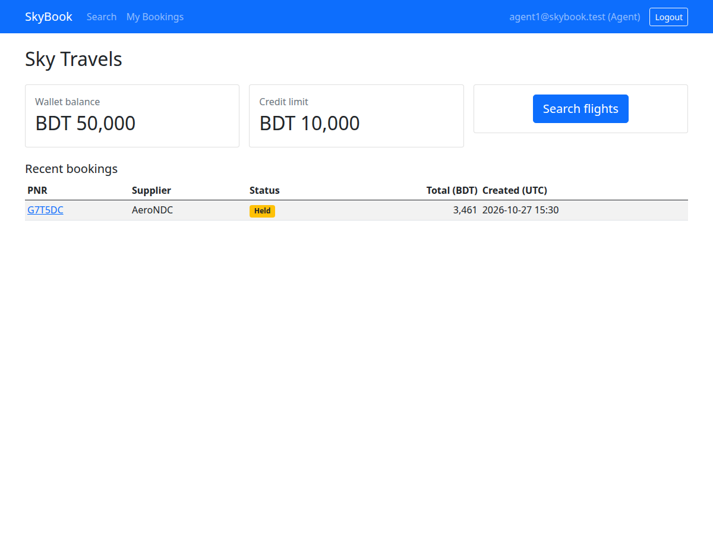
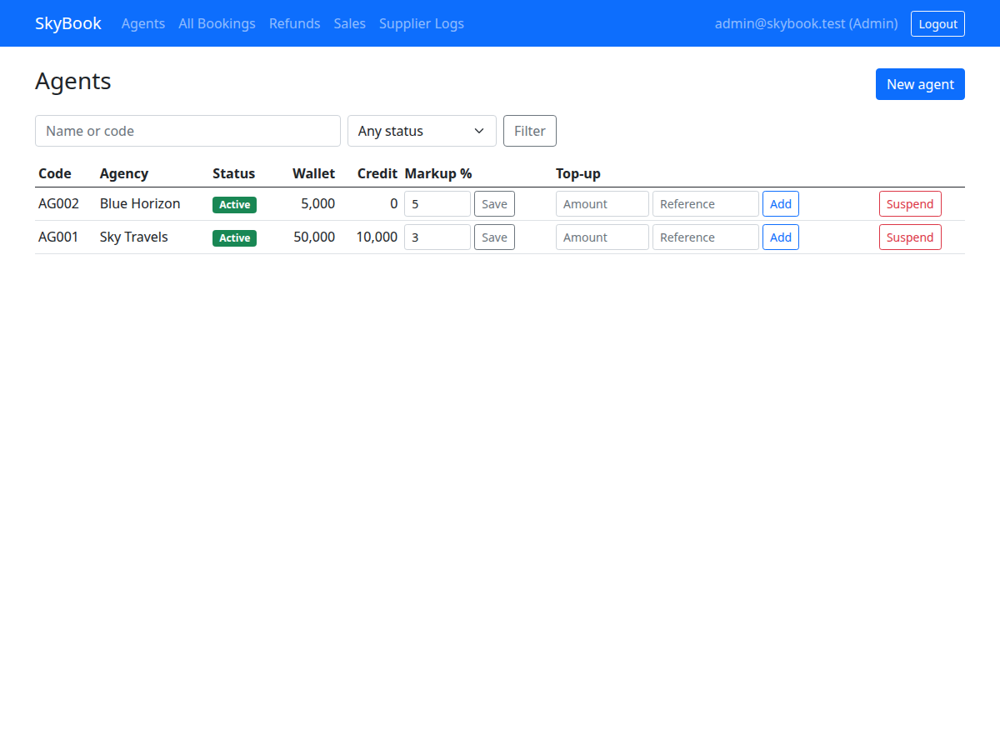
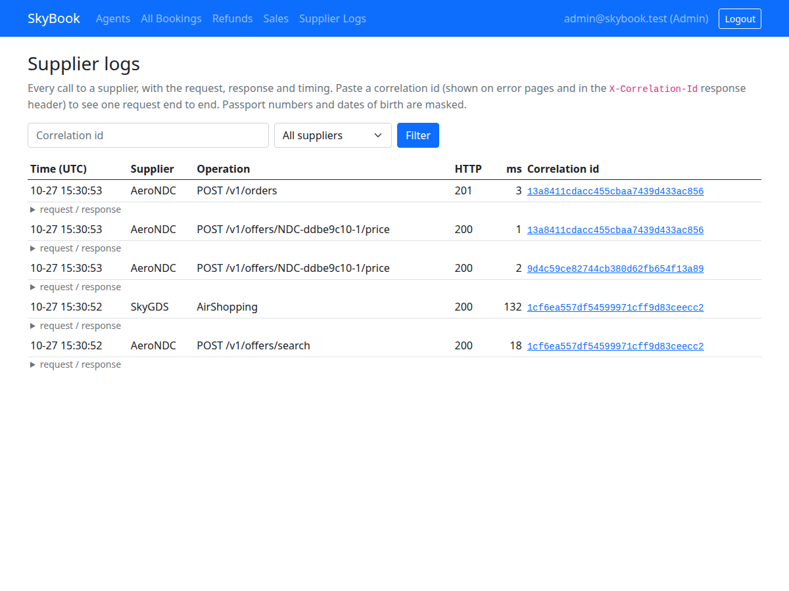

# SkyBook OTA – Flight Booking Web App (ASP.NET Core MVC)


An online travel agency web app. Travel agents search flights aggregated from a SOAP-based GDS and a
REST-based NDC airline API, then book, ticket, cancel and refund. Admins manage agents, wallets, markup
and troubleshoot supplier calls.



## Features
- Parallel multi-supplier flight search (SOAP/XML + REST/JSON) with partial-failure handling and per-supplier timeouts
- Search → Price → Book (PNR) → Ticket → Cancel → Refund driven by a domain state machine ([docs](docs/booking-state-machine.md))
- Agent wallet; ticketing is an atomic SQL Server stored procedure (`UPDLOCK`, transaction)
- Admin area: agents, markup, wallet top-ups, booking search, refund approval, sales report, supplier logs
- Idempotent booking, price-change detection, automatic hold expiry (background job)
- Cookie auth with Admin/Agent roles, anti-forgery tokens, validation, per-agent data scoping
- Correlation ID on every log line and supplier call; PII masked in supplier logs
- Go microservice as the mock NDC airline

## Tech stack
ASP.NET Core 8 MVC (Razor) · C# · EF Core · Dapper · SQL Server · Polly resilience · Go · xUnit · Docker Compose · GitHub Actions

## Architecture


- **Domain**: entities, `BookingTransitions`, no dependencies.
- **Application**: supplier abstraction (`IFlightSupplier`), search/pricing services, passenger and pricing rules.
- **Infrastructure**: EF Core model + migrations, Dapper calls to stored procedures, SOAP and REST supplier clients, booking/admin services.
- **Web**: thin MVC controllers and views; `Admin` area; hold-expiry job.
- **MockGds** (C#, SOAP) and **mock-ndc-go** (Go, REST) stand in for real suppliers.

## Run it
```bash
docker compose up --build
```
Open http://localhost:5000 (first start takes ~30 s while SQL Server boots; the app retries, migrates and seeds itself).

| Role | Login | Notes |
|---|---|---|
| Agent | `agent1@skybook.test` / `Agent@123` | Sky Travels, wallet BDT 50,000, 3% markup |
| Agent | `agent2@skybook.test` / `Agent@123` | Blue Horizon, wallet BDT 5,000, 5% markup |
| Admin | `admin@skybook.test` / `Admin@123` | |

Without Docker: start SQL Server (`docker compose up -d sqlserver`), `go run .` in `mock-ndc-go`,
`dotnet run --project src/SkyBook.MockGds`, then `dotnet run --project src/SkyBook.Web` (set `ConnectionStrings:Default` with user-secrets).

## Try these scenarios
- Search **DAC → CGP**, pick an offer, book, issue the ticket, cancel it, then approve the refund as admin.
- **Supplier failure**: search with a destination of `SLW` → GDS takes 8 s and times out; AeroNDC results still appear with a warning.
- **SOAP fault**: origin `ERR` against the GDS returns a fault that is shown as a warning, not a crash.
- **Price change**: select SkyGDS offers repeatedly; the mock re-prices higher half the time and the UI asks you to confirm.
- **Insufficient balance**: log in as agent2 (BDT 5,000) and ticket a more expensive fare.
- **Isolation**: open agent1's booking URL as agent2 → 404.

## Design decisions
- **EF Core + Dapper**: EF for CRUD and migrations; Dapper for the stored procedures where the SQL (locking, reporting) is the point.
- **Book/Ticket/Cancel are never retried**: a retry could create a second booking at the airline. Search/price use a retrying client; mutating calls use a separate no-retry client.
- **Supplier ticketed but DB update failed**: logged as a critical `RECONCILE` event and surfaced to the user with the PNR, rather than hidden. See [state machine notes](docs/booking-state-machine.md).
- **POST + redirect (PRG) with anti-forgery** for every state change; double submits are absorbed by an idempotency key.
- **404 not 403** for another agent's booking, so PNRs cannot be probed.
- **Indexing**: measured in [docs/db-performance-notes.md](docs/db-performance-notes.md).

## Testing
```bash
dotnet test tests/SkyBook.UnitTests          # domain, supplier mapping, aggregator, controllers
docker compose up -d sqlserver
dotnet test tests/SkyBook.IntegrationTests   # whole app in memory + real SQL Server, fake airline
SKYBOOK_URL=http://localhost:5000 python3 tests/e2e/smoke_e2e.py   # against the running compose stack
cd mock-ndc-go && go test ./...
```
Integration tests are skipped (not failed) when SQL Server is not reachable; set `SKYBOOK_TEST_DB` to use another server
(the database name must contain "Test" because it is dropped on every run).
Manual cases: [docs/test-cases.md](docs/test-cases.md). Postman collection for the mock suppliers: [postman/](postman/).

## Screenshots
| Login | Search results |
|---|---|
|  |  |

| Review & passengers | Booking details |
|---|---|
|  |  |

| My bookings | Dashboard |
|---|---|
|  |  |

| Admin: agents | Admin: supplier logs |
|---|---|
|  |  |
